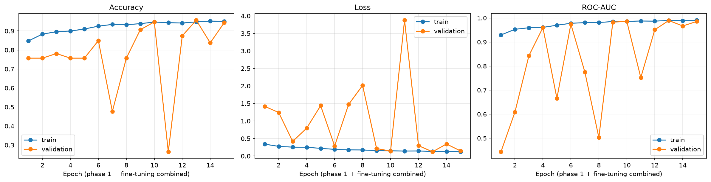
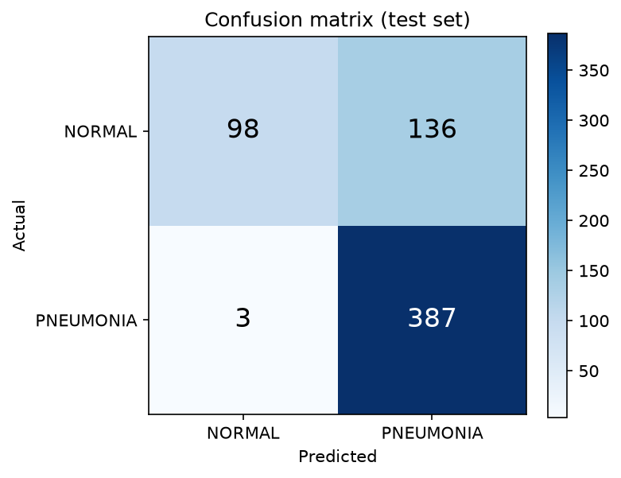
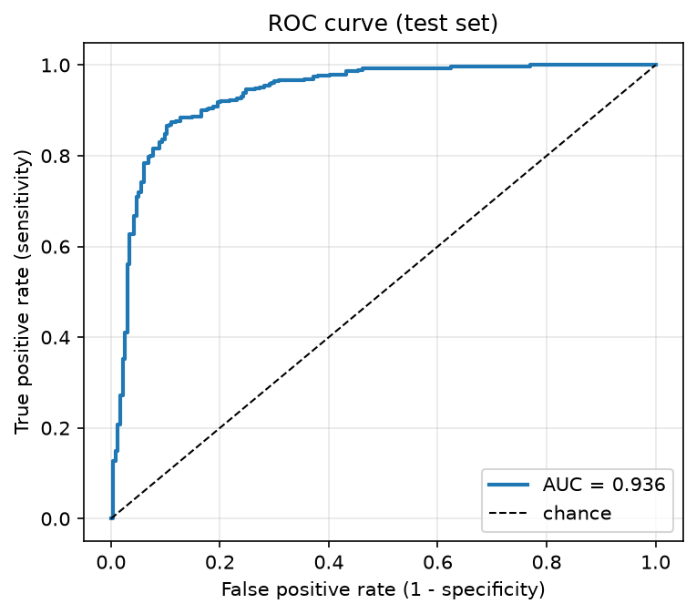
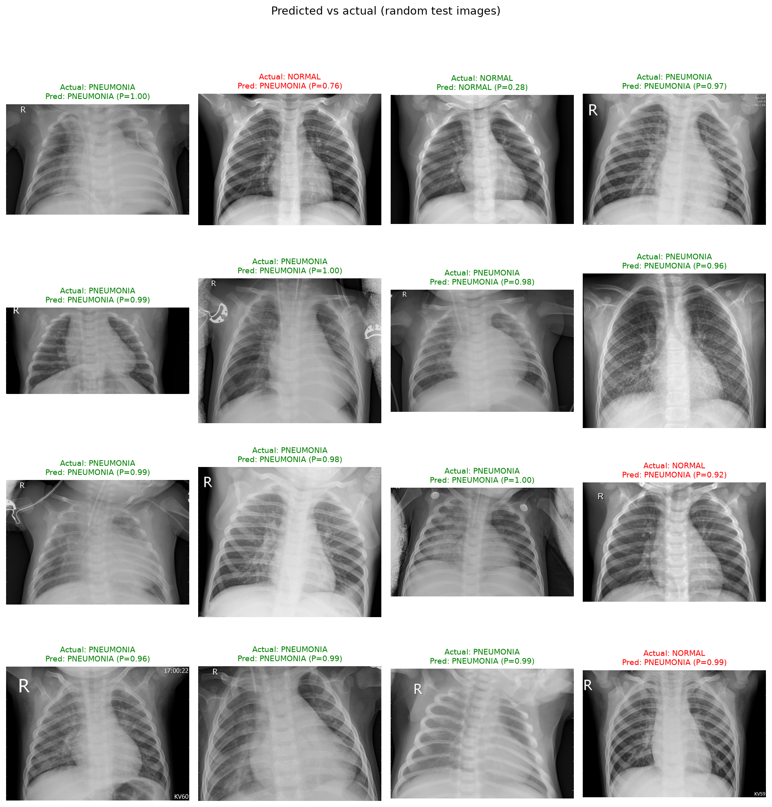
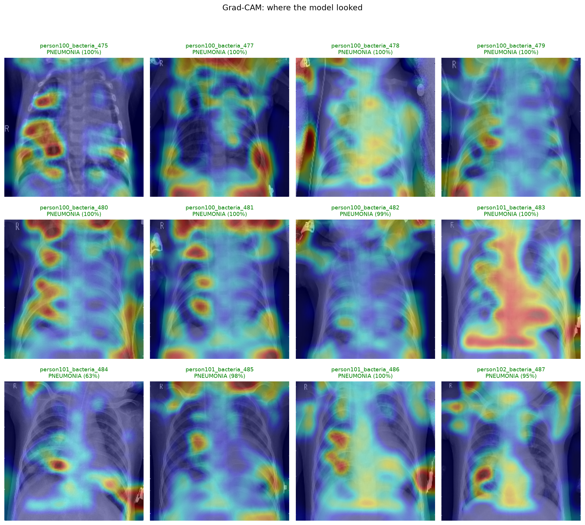
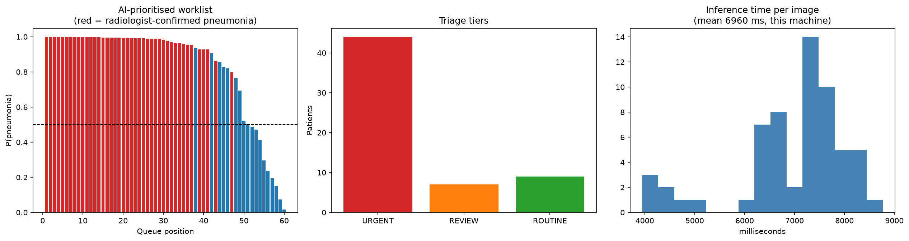

# AI-Powered Medical Image Analysis


A deep-learning pipeline that classifies **chest X-rays as NORMAL or PNEUMONIA**, with
explainability (Grad-CAM), a REST API, and a **virtual-hospital triage simulation**.
Built on a public dataset, so no real hospital access is needed.

> **Disclaimer:** educational project. Not a medical device, not clinically validated, and it
> must never be used to diagnose or treat real patients.

## Overview

| | |
|---|---|
| **Task** | Binary image classification: NORMAL vs PNEUMONIA |
| **Data** | Kaggle *Chest X-Ray Images (Pneumonia)* - 5,863 pediatric chest X-rays (Kermany et al., *Cell*, 2018), CC BY 4.0 |
| **Model** | MobileNetV2 transfer learning (ImageNet weights) with 2-phase fine-tuning; small custom CNN as a baseline (`--arch cnn`) |
| **Framework** | Python, TensorFlow/Keras 3, OpenCV, NumPy, scikit-learn, Matplotlib, Flask |
| **Extras** | Class-imbalance handling, Grad-CAM, error analysis, REST API + web page, triage simulation, unit tests + CI |

## Problem statement
Radiologists read large volumes of chest X-rays, and urgent cases can wait in a queue behind routine ones.
This project explores how an AI "second reader" can **flag likely pneumonia studies** so they are reviewed
sooner, while the final diagnosis always stays with the doctor.

## Industry relevance
Triage and worklist prioritisation, second-reader support and quality control are real, commercially
active areas of radiology AI. This repo reproduces the *engineering workflow* behind them (data checks,
imbalance handling, honest evaluation, explainability, serving) on public data.

## Architecture
```
 X-ray (JPEG/PNG)
      |
      v
 decode -> resize 224x224 -> 3 channels (raw 0-255 pixels)
      |
      v   +---------------- inside the saved model ----------------+
      |   | augmentation (train only) -> rescale -> MobileNetV2     |
      |   | -> global avg pool -> dropout -> Dense(1, sigmoid)      |
      |   +---------------------------------------------------------+
      v
 P(PNEUMONIA) -> threshold -> label + confidence -> Grad-CAM heatmap
      |
      +--> evaluation (confusion matrix, ROC) / REST API / triage simulation
```
Details: [docs/03_architecture.md](docs/03_architecture.md).

## Project structure
```
AI-Medical-Image-Analysis/
├── data/            # dataset goes here (git-ignored)
├── notebooks/       # Colab quickstart
├── src/             # config, data, preprocessing, model, train, evaluate, predict, gradcam, simulate, api
├── scripts/         # synthetic-data generator (tests/CI), dataset download helper
├── tests/           # pytest suite
├── models/          # trained weights (git-ignored)
├── outputs/         # generated metrics + figures (git-ignored)
├── images/          # figures you choose to show in this README
├── docs/            # full guides, model card, interview Q&A
├── main.py          # command-line entry point
├── requirements.txt
└── .gitignore
```

## Installation

Python **3.10, 3.11 or 3.12** is required (TensorFlow does not support newer versions yet at the time of writing - check the TensorFlow install page if `pip` cannot find it).

**Windows (PowerShell)**
```powershell
git clone https://github.com/<your-username>/AI-Medical-Image-Analysis.git
cd AI-Medical-Image-Analysis
py -3.11 -m venv .venv
.venv\Scripts\Activate.ps1
python -m pip install --upgrade pip
pip install -r requirements.txt
```
If activation is blocked: `Set-ExecutionPolicy -Scope Process Bypass`. Native Windows TensorFlow runs on CPU only; for a GPU use **Google Colab** (`notebooks/colab_quickstart.ipynb`) or WSL2.

**macOS / Linux**
```bash
git clone https://github.com/<your-username>/AI-Medical-Image-Analysis.git
cd AI-Medical-Image-Analysis
python3 -m venv .venv
source .venv/bin/activate
python -m pip install --upgrade pip
pip install -r requirements.txt
```

Verify the install and the code (about a minute, uses synthetic data - no download needed):
```bash
pip install pytest
python -m pytest -q tests
```

## Dataset
1. Open <https://www.kaggle.com/paultimothymooney/chest-xray-pneumonia> and download the zip (free Kaggle account).
2. Unzip into `data/` so you have `data/chest_xray/train`, `.../test`, `.../val` (a nested `chest_xray/chest_xray` folder is also detected automatically). Delete any `__MACOSX` folder.
3. Check it: `python main.py check-data`

Or with the Kaggle CLI (token in `~/.kaggle/kaggle.json`): `bash scripts/download_dataset.sh`

Expected: 5,216 train / 624 test / 16 val images; about 74% of the training images are PNEUMONIA.

## Usage
```bash
python main.py check-data              # verify dataset, print counts
python main.py explore                 # sample images, class balance, preprocessing + augmentation figures
python main.py train                   # MobileNetV2 transfer learning (CPU: slow, GPU/Colab: ~10-20 min)
python main.py evaluate                # accuracy, sensitivity, specificity, AUC, confusion matrix, ROC
python main.py predict --image data/chest_xray/test/PNEUMONIA --gradcam
python main.py simulate --patients 60  # virtual hospital triage run
python main.py serve                   # API + upload page at http://127.0.0.1:5000
```
Quick CPU-friendly baseline: `python main.py train --arch cnn --epochs 20`.

API example:
```bash
curl -F "image=@path/to/any_xray.jpeg" "http://127.0.0.1:5000/predict?gradcam=true"
```

## Results
After training on the real dataset, run `python main.py evaluate`, paste **your own** numbers from
`outputs/results_table.md` here, then fill `images/` automatically:
```bash
python scripts/collect_proof_images.py
```
Do not publish numbers you did not produce. To preview what each figure looks like before you train, see
[docs/sample_outputs_synthetic/](docs/sample_outputs_synthetic/) (fake data, stamped with a red banner).

<!-- PASTE outputs/results_table.md HERE -->

| Training curves | Confusion matrix | ROC curve |
|---|---|---|
|  |  |  |

| Predicted vs actual | Grad-CAM | Triage simulation |
|---|---|---|
|  |  |  |

**Read this before quoting accuracy.** The official test set is small (624 images), comes from one
pediatric population, and is known to be harder than the validation data. In medicine, **sensitivity**
(missed pneumonia) and **specificity** (false alarms) matter more than a single accuracy number. Include
the confusion matrix and the limitations below.

## Limitations (be honest about these - interviewers like it)
- Single dataset, pediatric patients, one hospital system; no external validation.
- Images from the same patient may appear in several files, so a random train/validation split can leak.
- Labels come from the dataset authors; the model can learn shortcuts (markers, devices) - check Grad-CAM.
- Binary task only: it cannot say *which* pneumonia, or detect other findings.
- Not calibrated or clinically validated.

See [docs/MODEL_CARD.md](docs/MODEL_CARD.md).

## Documentation
[Project explanation](docs/01_project_explanation.md) · [Tech stack options](docs/02_tech_stack_options.md) ·
[Architecture](docs/03_architecture.md) · [Phases](docs/04_implementation_phases.md) ·
[Simulation](docs/05_simulation.md) · [GitHub guide](docs/06_github_guide.md) ·
[7-day proof plan](docs/07_proof_plan.md) · [Interview Q&A](docs/08_interview_qa.md) ·
[Fixes to the original draft](docs/09_corrections_to_original.md)

## Learning outcomes
Image pipelines with `tf.data`; transfer learning and fine-tuning; class imbalance; metrics beyond accuracy;
Grad-CAM; train/serve skew; serving a model with Flask; testing ML code; reproducible repos.

## Citation
Kermany, D. S. et al. *Identifying Medical Diagnoses and Treatable Diseases by Image-Based Deep Learning.* Cell, 2018. Dataset licence: CC BY 4.0.

## License
MIT - see [LICENSE](LICENSE).
